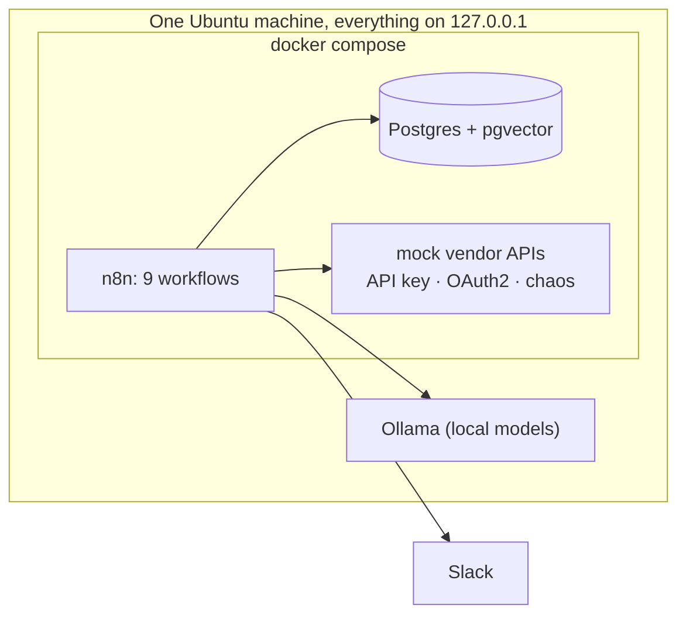

# license-ops-automation

**Self-hosted n8n automation that audits SaaS users and activity, reports license spend against budget, and turns vendor contracts into a searchable knowledge base. It runs on one machine, with a local language model.**

A portfolio project for the fictional company **Northwind Media**. All data is synthetic and the vendor APIs are mocks, so you need no vendor accounts. You do need a free Slack app (the results arrive in Slack).

<!-- DEMO GIF GOES HERE: audit digest arriving, monthly report, asking the contract chat, a failure alert -->

## What it does

| Workflow | What you get |
|---|---|
| **A. Usage audit** (daily) | Pulls users and activity from four SaaS APIs and an HR directory, normalises them, and posts one Slack digest of new findings: inactive seats, orphaned accounts, premium seats barely used, duplicate accounts. On the sample data it finds all 42 planted issues, about $600 a month in idle or wrong seats. |
| **B. Spend report** (monthly, or on demand) | Actual vs committed vs budget per tool and team, cost per active user, idle cost and month-over-month change. A local model writes the summary from the aggregated numbers only. Slack post plus a CSV. |
| **C. Contracts** | Drop in a contract PDF: a model extracts the terms into a fixed schema, named checks validate them, and the text is chunked and embedded. Then ask questions in natural language and get answers with sources, or "that is not in the contracts". |
| **D. Renewal alerts** (daily) | Alerts at 90, 60 and 30 days before the notice deadline, once each, with an optional Jira ticket. |
| **E, F, R. Operations** | Shared error handler, weekly health summary, and a replay workflow for failed embeddings. |

## Architecture



Details, per-workflow diagrams and the data model: [docs/architecture.md](docs/architecture.md).

## Reliability

This is the part the project is built around. Each item below was tested by breaking it on purpose; the results are in [docs/failure-testing.md](docs/failure-testing.md). The contract Q&A has a measured evaluation (retrieval hit rate, answer correctness, refusals): [docs/rag-evaluation.md](docs/rag-evaluation.md).

- **Idempotent writes.** Every write has a natural key and `ON CONFLICT`. Every workflow was run twice and created zero duplicates.
- **Retries and partial results.** Vendor calls retry; a vendor that stays down is skipped, recorded in `dead_letter`, named in the Slack digest, and the run is marked `partial`.
- **Dead letter and replay.** Rejected records and failed steps are stored with enough context to retry. A replay workflow re-embeds contract chunks whose embedding failed.
- **Error workflow.** Any failure posts to Slack, writes `dead_letter` and closes the run-log row. It does not depend on the database, so it still alerts when Postgres is down.
- **Run log and weekly health.** Every run is a row in `workflow_runs`; a Monday summary reports success rate, duration and open dead letters.
- **Safe automation.** A model's output is validated, never trusted: a contract that disagrees with an existing one goes to human review instead of overwriting it. Renewal alerts are claimed before sending, so overlapping runs cannot double-send.

## Privacy by design

- **User and activity data never leaves the machine.** It is processed by SQL, code and the local model only.
- **The finance summary is written by a local model** that sees aggregated numbers, never names or emails.
- **Contract text** is the only data that may go to an external model, and only if you switch `llm_provider` to `anthropic`. The default is `ollama`: everything runs locally and needs no API key.
- All ports are bound to `127.0.0.1`. Every webhook needs a header key. Slack interactivity (a public endpoint) is deliberately not used.

## Quick start

You need: Docker with Compose, Python 3.12+, [Ollama](https://ollama.com) on the same machine, and a Slack app.

1. **Ollama.** Set it up so containers can reach it ([docs/ollama-setup.md](docs/ollama-setup.md)), then `ollama pull nomic-embed-text` and `ollama pull llama3.1:8b`.
2. **Slack.** Create the app and the bot token ([docs/slack-setup.md](docs/slack-setup.md), about 5 minutes).
3. **Clone and configure.**
   ```bash
   git clone https://github.com/renehiler-rgb/license-ops-automation.git
   cd license-ops-automation
   cp .env.example .env          # then put your token in .env as SLACK_BOT_TOKEN
   ```
4. **Bootstrap.**
   ```bash
   scripts/bootstrap.sh
   ```
   It fills the other secrets in `.env`, generates the synthetic data, starts the stack, loads the base data, creates the n8n owner and credentials, and imports and publishes all workflows (about a minute). Prefer to do it by hand, or something went wrong? [docs/manual-setup.md](docs/manual-setup.md).
5. **Try it.** Open <http://localhost:5678> (login is printed at the end of the script).
   ```bash
   # A: in n8n open "A - Usage audit" and click Execute workflow, then compare with the planted issues
   .venv/bin/python scripts/check_audit.py

   KEY=$(grep ^INTAKE_API_KEY .env | cut -d= -f2)
   # B: the spend report for last month (GNU date; or write the month yourself, for example 2026-09)
   MONTH=$(date -d 'last month' +%Y-%m)
   curl -X POST localhost:5678/webhook/spend-report -H "X-Intake-Key: $KEY" -H 'Content-Type: application/json' -d "{\"month\":\"$MONTH\"}"
   # C: ingest the sample contracts, then ask a question
   scripts/post_contract.sh data/sample-contracts/*.pdf
   curl -X POST localhost:5678/webhook/ask-contracts -H "X-Intake-Key: $KEY" -H 'Content-Type: application/json' -d '{"question":"Which contracts auto-renew?"}'
   # D: in n8n run "D - Renewal alerts": three contracts are at their 90, 60 and 30 day marks
   ```
   The report month must be within the last 4 months (the generated budgets cover that). To see the failure handling, set `CHAOS_RATE=0.3` in `.env`, run `docker compose up -d mock-vendors`, and run A again.

**Optional.** Jira tickets for renewals: [docs/workflow-d-renewal-alerts.md](docs/workflow-d-renewal-alerts.md). A better local model for contract questions: `ollama pull qwen2.5:32b`, then set `ollama_extract_model` in `app_config` (about 19 GB, fits a 24 GB GPU). Claude instead of the local model: set `ANTHROPIC_API_KEY`, create the credential, and set `llm_provider` to `anthropic`.

## Configuration

Feature flags and thresholds are rows in the `app_config` table, not environment variables, so you can change them without redeploying:
```bash
docker compose exec postgres psql -U licenseops -d licenseops -c "select key, value from app_config order by key"
```

| Key | Default | Meaning |
|---|---|---|
| `llm_provider` | `ollama` | `ollama` (local) or `anthropic` for extraction and answers |
| `ollama_extract_model` / `ollama_summary_model` / `ollama_embed_model` | `llama3.1:8b` / `llama3.1:8b` / `nomic-embed-text` | models for extraction and answers, the spend summary, embeddings |
| `ollama_url` | `http://host.docker.internal:11434` | where n8n reaches Ollama |
| `inactive_days`, `new_account_grace_days` | 30, 14 | when a seat counts as inactive |
| `mismatch_window_days`, `mismatch_min_avg_activity` | 30, 3 | when a premium seat counts as barely used |
| `usage_initial_days` | 120 | how far back the first sync pulls usage |
| `renewal_thresholds` | `[90, 60, 30]` | days before the notice deadline that trigger an alert |
| `post_empty_digest` | `false` | post a "no new findings" line to Slack |
| `slack_channel_alerts` / `_reports` / `_renewals` | `#automation-alerts` / `#license-reports` / `#license-reports` | where messages go |
| `jira_enabled`, `jira_base_url`, `jira_project_key`, `jira_issue_type` | off, empty, empty, `Task` | optional Jira tickets |
| `anthropic_model` | `claude-haiku-5-5` | only with `llm_provider = anthropic` |

## Repository layout

| Path | Contents |
|---|---|
| `docker-compose.yml` | n8n, Postgres + pgvector, mock vendor API |
| `db/init/` | schema, views and seed config, applied in filename order on first start |
| `mock-vendors/` | FastAPI app imitating four SaaS APIs and an HR directory |
| `workflows/` | exported n8n workflows; `workflows/snippets/` holds every Code node and SQL query as a readable file |
| `scripts/` | `bootstrap.sh`, data generator and loader, contract PDF generator, check scripts, secret scan |
| `sample-contracts/` | example synthetic contract PDFs (bootstrap makes a set that matches your data in `data/sample-contracts/`) |
| `docs/` | architecture, one page per workflow, Slack and Ollama setup, failure testing |

## Roadmap

- Seat reclamation with approval buttons in Slack (needs a signed, authenticated public endpoint).
- Hiring-forecast provisioning and natural-language license requests.
- n8n queue mode with a worker, and n8n's own database on Postgres.
- A Supabase variant, a GitHub Action that runs the stack and the check scripts, and Prometheus metrics.
- A `slack_enabled` switch for trying the stack without a Slack app.

## What I learned

- **Test from a clean clone.** My own setup hid three bugs: a port variable that silently reconfigured n8n, a Slack token handed to a container that did not need it, and sample PDFs whose dates depended on the day the data was generated. A fresh clone found them in minutes.
- **A failure path is only real once you have run it.** My error handler read the wrong input and needed the database it was reporting on. Both were invisible until I stopped Postgres on purpose.
- **Idempotency is a design decision, not a retry flag.** Claiming a renewal alert before sending it removed duplicates, but only a claim that expires after a crash made it safe.

Built with [Claude Code](https://claude.com/claude-code). All data is synthetic.
