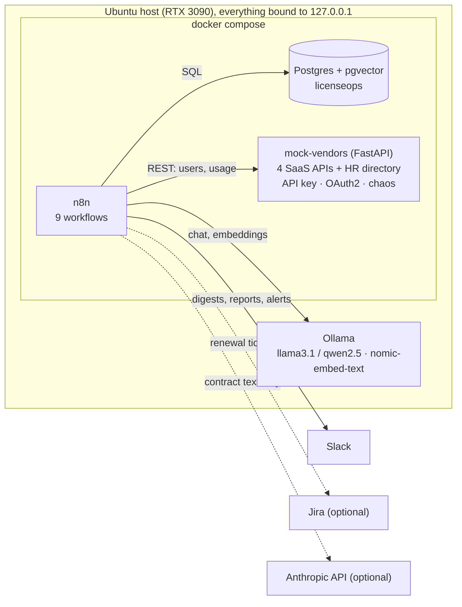
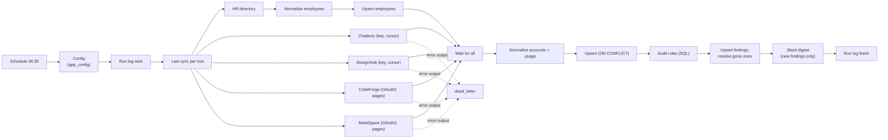
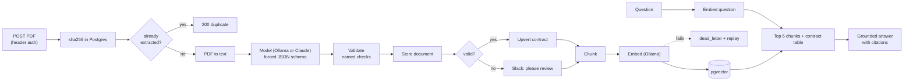

# Architecture

## Overview

Postgres is the system of record. n8n holds only the workflow definitions and its own credentials. Ollama runs on the host and is reached through `host.docker.internal`; it listens on the Docker bridge address only.
The vendor APIs are mocks that behave like real ones: different field names, date formats and pagination per vendor, API key and OAuth2 (client credentials) authentication, and deliberate random failures (`CHAOS_RATE`).

## Workflows

| | Trigger | Purpose |
|---|---|---|
| **A** Usage audit | daily 06:30 | pull users and activity from 4 vendors + HR, normalise, store, flag findings, Slack digest |
| **B** Spend report | 1st of the month 08:30, or webhook | actual vs committed vs budget per tool and team, local-model summary, Slack + CSV |
| **C1** Contract intake | webhook (PDF) | PDF to text, model extraction, validation, upsert, chunk, embed |
| **C2** Ask the contracts | webhook or chat page | similarity search + contract table, grounded answer with sources |
| **D** Renewal alerts | daily 07:30 | notice-deadline alerts at 90/60/30 days, optional Jira ticket |
| **E** Error handler | on failure of any workflow | Slack alert, `dead_letter` row, closes the failed run's log row |
| **F** Weekly health | Mondays 09:00 | success rate, duration and open dead letters per workflow |
| **R** Replay | webhook or manual | re-embeds chunks whose embedding failed |
| Run log | called by the others | `workflow_runs` row at start and finish |

### A: usage and activity audit

Each fetch retries 4 times; a vendor that stays down goes to `dead_letter` and the digest says which vendors failed. Rejected records (bad date, no id, bad email) also go to `dead_letter` instead of being dropped. Findings: inactive seats, orphaned accounts, premium seats barely used, duplicate accounts, more accounts than licensed seats.

### C: contracts

## Data model (Postgres `licenseops`)
- **Master data** (loaded from the generator): `tools`, `employees`, `contracts`, `budgets`.
- **Synced by workflow A:** `accounts`, `usage_daily`; findings in `audit_findings` (unique per type + account + email, with `first_seen`, `last_seen`, `resolved_at`, `notified_at`).
- **Operations:** `app_config` (all flags and thresholds), `workflow_runs`, `dead_letter`, `renewal_alerts`, `monthly_reports`.
- **RAG:** `contract_documents` (sha256 unique), `contract_chunks` (`vector(768)` with an HNSW cosine index).
- **Views:** `v_seat_utilisation`, `v_spend_by_team_month`, `v_monthly_spend`, `v_budget_variance`.

## Design rules
1. **Idempotent:** every write has a natural key and `ON CONFLICT`. Re-running any workflow creates no duplicates (tested, see [failure-testing.md](failure-testing.md)).
2. **Config in the database:** flags and thresholds are rows in `app_config`, changeable without redeploying.
3. **Secrets only in n8n credentials and `.env`** (gitignored). The n8n container receives only its encryption key.
4. **Personal data stays local:** user and activity data is processed by SQL, code and Ollama only. Contract text is the only thing that can go to an external model, and only if you switch to it.
5. **Every workflow logs** a run-log row and has the error workflow set. A run that dies is closed as failed.
6. **Network:** all published ports are `127.0.0.1`; webhooks need a header key; Slack interactivity (public endpoints) is deliberately not used.
